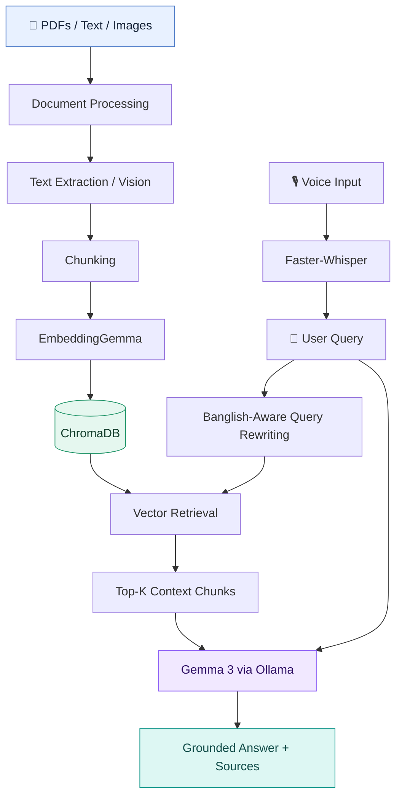

# 🌐 Banglish RAG Assistant

### A Self-Hosted, Multilingual AI Assistant for Bangla, English & Banglish

  <strong>Chat with your documents. Speak naturally. Keep control of your data.</strong>

  A document-aware AI assistant combining local LLMs, semantic retrieval, multimodal understanding, and speech recognition in one interface.

  
  
  
  
  

  

---

## ✨ Overview

**Banglish RAG Assistant** is a self-hostable AI application designed for natural conversations and document-grounded question answering in **Bangla, English, and Banglish** (Bangla written using English characters).

Powered by Ollama, Gemma 3, EmbeddingGemma, and ChromaDB, it combines large language models with retrieval-augmented generation (RAG) to help users explore their own documents through a conversational interface.

From asking questions about PDFs and scanned pages to exploring images and interacting through voice, the assistant brings multiple AI capabilities into a single workflow.

> **Built for multilingual knowledge access, document intelligence, and locally deployable AI.**

## 🚀 Key Features

<table>
  <tr>
    <td width="50%">
      <h3>💬 Multilingual Conversations</h3>
      Ask questions and interact in Bangla, English, or Banglish, including mixed-language queries.
    </td>
    <td width="50%">
      <h3>📚 Document Intelligence</h3>
      Retrieve relevant information from PDFs, Markdown files, text documents, and supported images.
    </td>
  </tr>
  <tr>
    <td width="50%">
      <h3>🧠 Retrieval-Augmented Generation</h3>
      Combine semantic search with retrieved context to generate document-grounded answers.
    </td>
    <td width="50%">
      <h3>👁️ Vision & Scanned Documents</h3>
      Use Gemma 3 Vision capabilities to interpret supported images and scanned document pages.
    </td>
  </tr>
  <tr>
    <td width="50%">
      <h3>🎙️ Voice Interaction</h3>
      Convert speech into text using Faster-Whisper with the <code>large-v3</code> model.
    </td>
    <td width="50%">
      <h3>🔎 Cross-Language Retrieval</h3>
      Rewrite Banglish queries and improve retrieval across Bangla-English language variations.
    </td>
  </tr>
  <tr>
    <td width="50%">
      <h3>📎 Source-Aware Responses</h3>
      Present citation references such as <code>[1]</code> and <code>[2]</code> when supported by retrieved context.
    </td>
    <td width="50%">
      <h3>⚙️ Flexible Answer Modes</h3>
      Choose between document-focused answers, automatic retrieval, and general-knowledge responses.
    </td>
  </tr>
</table>

## 🖥️ Answer Modes

| Mode | Description |
|---|---|
| **Auto** | Uses document retrieval with general knowledge as a fallback. |
| **My Documents Only** | Restricts answers to information retrieved from uploaded documents. |
| **General Knowledge Only** | Answers without using uploaded-document context. |

For sensitive company policies or other authoritative information, prefer document-focused mode and verify that missing information is not invented.

## 🏗️ System Architecture

The application follows a retrieval-augmented generation pipeline that connects document ingestion, semantic retrieval, and language generation.

### How It Works

1. **Ingestion:** Upload supported documents or images.
2. **Extraction:** Extract text from PDFs and process supported scanned pages and images.
3. **Chunking:** Split extracted content into manageable overlapping segments.
4. **Embedding:** Encode document chunks using EmbeddingGemma.
5. **Indexing:** Store the resulting vectors in ChromaDB.
6. **Query processing:** Rewrite Banglish queries when enabled to improve cross-language retrieval.
7. **Retrieval:** Find the most relevant document chunks for the question.
8. **Generation:** Pass the query and retrieved context to Gemma 3 through Ollama.
9. **Response:** Stream the generated answer and provide source references when available.

## 🧰 Technology Stack

| Component | Technology | Purpose |
|---|---|---|
| Programming Language | Python | Application logic |
| LLM Runtime | [Ollama](https://ollama.com/) | Local model inference |
| Chat & Vision Model | `gemma3:4b` / `gemma3:12b` | Response generation and image understanding |
| Embedding Model | `embeddinggemma` | Semantic vector embeddings |
| Vector Database | [ChromaDB](https://www.trychroma.com/) | Document indexing and retrieval |
| Speech Recognition | [Faster-Whisper](https://github.com/SYSTRAN/faster-whisper) | Voice transcription |
| PDF Processing | [PyMuPDF](https://pymupdf.readthedocs.io/) | PDF text extraction |
| User Interface | [Gradio 5](https://www.gradio.app/) | Interactive chat application |

## ⚡ Quick Start — Kaggle

The current notebook-based workflow is designed for Kaggle with internet access and GPU acceleration.

### 1. Prepare the notebook

Upload `banglish_rag_assistant.ipynb` to a new Kaggle notebook.

### 2. Configure the environment

In notebook settings, enable:

- **Accelerator:** GPU
- **Internet:** On
- **GPU:** T4 × 2 recommended when available

Resource availability depends on your Kaggle account and session.

### 3. Run the notebook

Execute the notebook cells in order:

| Cell | Action |
|---|---|
| Cell 1 | Install Ollama and Python dependencies |
| Cell 2 | Start Ollama and download the required models |
| Cell 3 | Launch the Gradio application |

### 4. Open the application

Open the Gradio URL generated by the notebook and start chatting with your documents.

> **Note:** Public Gradio share links are temporary. Re-running the launch cell may generate a new link. Anyone with access to an unauthenticated public link may be able to use the application.

## ⚙️ Configuration

The following settings can be adjusted near the top of the notebook.

| Setting | Default | Description |
|---|---|---|
| `CHAT_MODEL` | `gemma3:4b` | Chat and vision model; `gemma3:12b` is an alternative. |
| `WHISPER_MODEL` | `large-v3` | Speech-recognition model; smaller variants may reduce resource requirements. |
| `CHUNK_WORDS` | `150` | Approximate chunk size in words. |
| `CHUNK_OVERLAP` | `30` | Overlap between consecutive chunks. |
| `DIST_MAX` | `0.65` | Relevance cutoff used in Auto mode; confirm the distance metric and threshold behavior in the implementation. |
| `REWRITE_QUERY` | `True` | Enable query rewriting for Banglish and cross-language search. |
| `BANGLISH_REPLY` | `banglish` | Set to `bangla` to respond in Bangla script. |
| `AUTH` | `None` | Optional Gradio authentication credentials. |

**Performance tip:** Larger language and speech models can improve some tasks but require more memory and compute. Choose model sizes according to the available hardware.

## 🎯 Use Cases

- **Research & Education:** Ask questions about academic papers, lecture notes, and study materials.
- **Document Intelligence:** Explore large collections of PDFs and text files conversationally.
- **Multilingual Knowledge Retrieval:** Search in Bangla or Banglish and retrieve relevant information from multilingual documents.
- **Scanned Document Analysis:** Extract and interpret information from supported scanned pages and images.
- **Local Knowledge Assistants:** Build document-grounded assistants for personal or organizational knowledge.
- **Customer Support Prototypes:** Answer questions using a company's policy and product documentation.

## 🔐 Privacy & Security

The project is designed for local model inference through Ollama, but local inference alone does not guarantee complete end-to-end privacy.

Before using sensitive documents:

- Review where files, embeddings, and conversation history are stored.
- Avoid exposing the Ollama API or Gradio interface publicly without appropriate access controls.
- Configure authentication when sharing the interface.
- Never upload confidential documents to an untrusted environment.
- Review the notebook's network access and temporary storage behavior.

### Deployment Considerations

The current Kaggle setup stores models and vector database data under `/tmp`. These files may be lost when the session ends, requiring models to be downloaded and documents to be indexed again.

For persistent usage, configure durable storage and access-controlled deployment infrastructure.

## ⚠️ Known Limitations

- Smaller language models may produce incomplete or incorrect answers, particularly for complex Bangla text and OCR-heavy documents.
- Retrieval quality depends on chunking, embedding quality, query rewriting, and document structure.
- Source references do not independently guarantee factual correctness.
- Speech recognition quality varies with language mixing, background noise, and recording quality.
- Model downloads and inference may require substantial disk space, RAM, and GPU memory.
- Public Gradio links should not be treated as secure private deployments unless access controls are configured.

Verify important answers against the original documents.

## 🛣️ Roadmap

- [ ] Hybrid retrieval combining BM25 and dense vector search
- [ ] Cross-encoder reranking for improved retrieval precision
- [ ] Persistent vector storage and document management
- [ ] Retrieval evaluation with Recall@K, MRR, and nDCG
- [ ] Answer evaluation for faithfulness and context relevance
- [ ] Improved Bangla and Banglish query understanding
- [ ] Authenticated multi-user access
- [ ] FastAPI backend for application integration
- [ ] Automated regression tests for hallucinations and prompt injection

## 🤝 Contributing

Contributions are welcome!

You can help improve:

- Bangla and Banglish retrieval quality
- Document parsing and OCR workflows
- Model inference performance
- Evaluation benchmarks
- UI accessibility and usability

To contribute, open an issue to discuss a proposed change or submit a pull request with a clear description of your improvement.

## 🙏 Acknowledgements

Built with the support of these open-source projects and model ecosystems:

- [Ollama](https://ollama.com/)
- [Gemma](https://ai.google.dev/gemma)
- [ChromaDB](https://www.trychroma.com/)
- [Faster-Whisper](https://github.com/SYSTRAN/faster-whisper)
- [Gradio](https://www.gradio.app/)
- [PyMuPDF](https://pymupdf.readthedocs.io/)

## 📄 License

This project is distributed under the [MIT License](LICENSE).

---

  <strong>Banglish RAG Assistant</strong> 
  Making multilingual knowledge more accessible, one question at a time.

  Built for Bangla • English • Banglish

